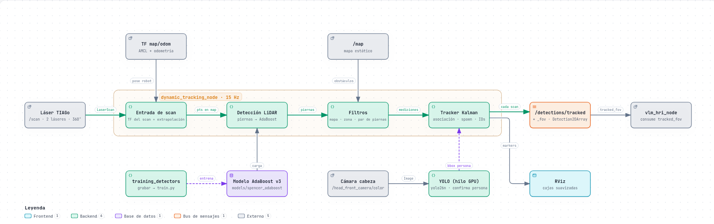

# DTF-Track: Dual-Tier Fusion for People Tracking

> 📄 **ROBOT 2026 – Iberian Robotics Conference** · 🌐 [Project page](https://ejbejaranosai.github.io/dtf-track/) · 📝 [How to cite](#citation)
>
> **If you use DTF-Track (code, models or results) in your research, please cite our paper.** See [Citation](#citation) below.

[](#quick-start)
[](#quick-start)
[](#license)

ROS 2 node for **360° people tracking** with a **2D LiDAR**, plus an optional **RGB camera (YOLO)** that confirms which tracks are people. Track positions and Kalman updates come from the LiDAR only; YOLO adds the label, the image box and (optionally) appearance Re-ID.

**Maintainer:** Edison Bejarano — [edison.bejarano@upc.edu](mailto:edison.bejarano@upc.edu) — IRI Mobile Robotics Group.

<p align="center">
  
</p>

---

## Quick start

**You need:** ROS 2 Humble or Jazzy, a robot (or simulation) publishing `/scan`, a `map` frame from localization (AMCL / Nav2) plus `/map`, and optionally an RGB camera. An NVIDIA GPU is recommended for YOLO; without one, see [No GPU](#options).

### 1. Install

```bash
mkdir -p ~/dtf_ws/src && cd ~/dtf_ws/src
git clone https://github.com/EjbejaranosAI/DTF-Track.git
cd ~/dtf_ws
rosdep install --from-paths src --ignore-src -y

# Python deps (YOLO, ONNX, Re-ID) in a venv that also sees the ROS packages
python3 -m venv --system-site-packages ~/dtf_venv
~/dtf_venv/bin/pip install -r src/DTF-Track/requirements.txt
```

### 2. Build

Build **without** the venv on `PYTHONPATH`, otherwise colcon breaks (`option --uninstall not recognized`):

```bash
cd ~/dtf_ws
unset PYTHONPATH
source /opt/ros/$ROS_DISTRO/setup.bash
colcon build --packages-select dynamic_tracking --symlink-install
```

### 3. Run

```bash
source ~/dtf_ws/install/setup.bash
export PYTHONPATH=$(echo ~/dtf_venv/lib/python3*/site-packages):$PYTHONPATH

# Real robot (TIAGo Pro defaults)
ros2 launch dynamic_tracking dynamic_tracking.launch.py profile:=robot use_rviz:=true area_filter_enable:=false

# Gazebo simulation
ros2 launch dynamic_tracking dynamic_tracking.launch.py profile:=sim use_rviz:=true use_sim_time:=true
```

> ⚠️ The `robot` profile ships with **our lab's detection zone** (`config/zones/lab_perimeter.yaml`), in the coordinates of our map. On any other map, keep `area_filter_enable:=false` or [make your own zone](#detection-zone).

### 4. Check

```bash
ros2 topic hz /detections/tracked      # ~10-15 Hz
ros2 topic echo /detections/tracked --once
```

In RViz (Fixed Frame `map`): `/dynamic_tracks_markers` shows the tracks, `/image_annotated` the camera with YOLO boxes.

---

## Options

All are launch arguments (`ros2 launch dynamic_tracking dynamic_tracking.launch.py ... <arg>:=<value>`):

| Want | Argument |
|---|---|
| Another camera / laser | `image_topic:=/my/camera/image_raw lidar_topic:=/my/scan` |
| LiDAR only (no camera, no GPU) | `enable_yolo_detections:=false` |
| No GPU, keep YOLO | `device:=cpu` (slower), or set `yolo_backend: onnx` in the YAML (uses `models/yolo/yolo26n_256.onnx`) |
| Recover a person's old ID by appearance | `enable_reid:=true` |
| Only track inside a zone | `area_filter_zones_file:=<name or path>` (see below) |
| Your own parameters | `params_file:=/path/to/params.yaml` |

Profiles: `profile:=robot` loads `config/dynamic_tracking_params.yaml`, `profile:=sim` loads `config/dynamic_tracking_params_sim.yaml`. Every parameter is commented in those files.

### Detection zone

A zone in the `map` frame removes false positives (furniture, walls) outside the area you care about. Tracks are only created inside it.

1. In RViz, use **Publish Point** to click the corners on the map while recording them:
   `ros2 topic echo /clicked_point`
2. Copy the `x, y` values into `config/zones/my_room.yaml`:
   ```yaml
   frame: map
   zones:
     - name: my_room
       add: true            # false = exclude this area
       polygon: [[0.0, 0.0], [4.0, 0.0], [4.0, 3.0], [0.0, 3.0]]   # closes itself
   ```
3. Rebuild, then launch with `area_filter_enable:=true area_filter_zones_file:=my_room`.

### Appearance Re-ID

With `enable_reid:=true`, an OSNet x0_25 embedding of each YOLO person crop lets a new track take back the ID of a person who was lost, once the camera sees them again (~5 ms per batch on GPU). Optional names:

```bash
ros2 topic pub --once /dynamic_tracking/reid/enroll std_msgs/String "data: '3:Alice'"
ros2 topic echo /dynamic_tracking/reid/identities
```

---

## Outputs

| Topic | Content |
|---|---|
| `/detections/tracked` | All tracks (`vision_msgs/Detection2DArray`, frame `map`) |
| `/detections/tracked_fov` | Only tracks with a fresh camera box |
| `/dynamic_tracks_markers` | RViz boxes, trails and labels |
| `/detection_area_markers` | RViz detection zone |
| `/image_annotated` (+ `/compressed`) | Camera image with YOLO boxes |
| `/dynamic_tracking/reid/identities` | Re-ID state (JSON), when enabled |

Per detection: `class_id` = `"<class>#<track_id>"` (e.g. `person#3`, `unknown#7` for a LiDAR-only track), `pose.pose.position` = Kalman position in `map` (z = 0), `bbox` = last YOLO box in pixels (all zeros when there is none).

RViz labels: green = person seen by YOLO recently, orange = person tracked by LiDAR only, blue = not confirmed as a person.

---

## Models

All weights are in `models/` and are installed with the package.

| File | What it is | Used by |
|---|---|---|
| `spencer_adaboost/tiago_v3_2026-10-14.adaboost` | LiDAR leg detector **trained on TIAGo Pro** (laser at 21 cm) | `robot` profile (default) |
| `spencer_adaboost/tiago_height21cm_v2.adaboost` | Previous TIAGo model | — |
| `spencer_adaboost/lms500_..._rathausgasse.adaboost`, `spencer_rf/*.random_forest.gz` | Original [SPENCER](https://github.com/spencer-project/spencer_people_tracking) models (laser at ~70 cm) | `sim` profile |
| `yolo/yolo26n_256.onnx` | YOLO26n for CPU (`yolo_backend: onnx`) | optional |
| `reid/osnet_x0_25_msmt17.pth` | OSNet x0_25 Re-ID ([kaiyangzhou/osnet](https://huggingface.co/kaiyangzhou/osnet), MIT) | `enable_reid:=true` |

`yolo26n.pt` (GPU backend) is downloaded automatically by Ultralytics on the first run.

**Different robot or laser height?** The leg detectors depend on the laser height and scanner. Retrain them with a few minutes of recordings from your robot: see [`training_detectors/README.md`](training_detectors/README.md).

---

## Troubleshooting

| Problem | Fix |
|---|---|
| `option --uninstall not recognized` or `PackageNotFoundError: dynamic_tracking` | The venv was on `PYTHONPATH` while building: `unset PYTHONPATH`, delete `build/dynamic_tracking install/dynamic_tracking`, rebuild |
| `TypeError: canonicalize_version() got an unexpected keyword argument 'strip_trailing_zero'` | Recent `setuptools` (≥71, pulled by torch) with an old `packaging` (<22, e.g. Ubuntu 22.04): `unset PYTHONPATH`, delete `build/dynamic_tracking install/dynamic_tracking`, rebuild. If you used `pip install --user`: `pip install --user "packaging>=22"` |
| `No module named 'ultralytics'` / `'onnxruntime'` | Export the venv `PYTHONPATH` (step 3) before launching |
| No tracks at all | Check `/scan` and the `map` TF (`ros2 run tf2_ros tf2_echo map <laser_frame>`); on another map use `area_filter_enable:=false` |
| No `/image_annotated` | Check the camera topic (`ros2 topic hz <image_topic>`); TIAGo cameras need `image_qos_reliability:=best_effort` |
| RViz fails over SSH | Launch with `use_rviz:=false` on the robot and open RViz on your laptop (same `ROS_DOMAIN_ID`) |

---

## Documentation

- Architecture (interactive): [`docs/architecture/dynamic_tracking_architecture.html`](docs/architecture/dynamic_tracking_architecture.html) (download and open in a browser)
- Pipeline: [`docs/PIPELINE.md`](docs/PIPELINE.md) · Tracking: [`docs/TRACKING.md`](docs/TRACKING.md) · LiDAR detectors: [`docs/LIDAR_DETECTORS.md`](docs/LIDAR_DETECTORS.md) · TF drift: [`docs/DRIFT_FIX.md`](docs/DRIFT_FIX.md)
- Retraining the leg detectors: [`training_detectors/README.md`](training_detectors/README.md)

<p align="center">
  
</p>

---

## Citation

If you use this tool in your work, please cite:

```bibtex
@inproceedings{bejarano2026dtftrack,
  title     = {{DTF-Track}: Dual-Tier Fusion for People Tracking},
  author    = {Bejarano, Edison and Bo, Valerio and Garrell, Ana{\'i}s and Sanfeliu, Alberto},
  booktitle = {ROBOT 2026: Iberian Robotics Conference},
  year      = {2026}
}
```

GitHub's **"Cite this repository"** button (right sidebar) uses [`CITATION.cff`](CITATION.cff).

---

## Acknowledgements

- **IRI** — Institut de Robòtica i Informàtica Industrial (CSIC-UPC)
- **UPC** — Universitat Politècnica de Catalunya · BarcelonaTech
- Supported by JST Moonshot R&D (grant JPMJMS2011) and the EU project TORNADO (HORIZON-CL4-2024-DIGITAL-EMERGING-01-101189557).

<p align="center">
  
  &nbsp;&nbsp;&nbsp;
  
</p>

## License

MIT (see `package.xml`).
