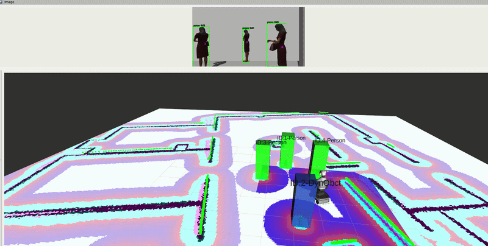
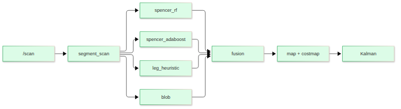
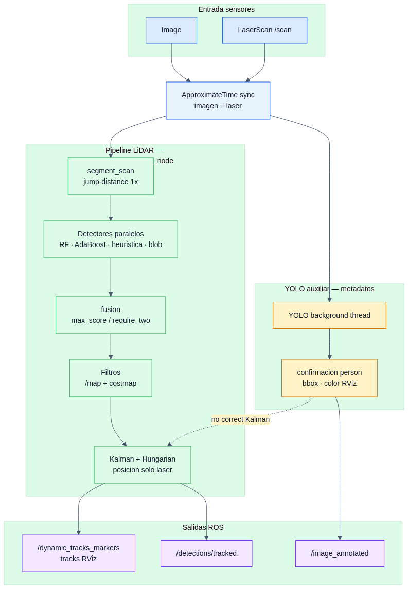

# Dynamic-tracking

> **If you use this project, please cite it.** Paper link (placeholder, will be updated once the paper is published): https://arxiv.org/abs/0000.00000

[](#quick-start)
[](#requirements)
[](#license)
[](#acknowledgements)

ROS 2 node for **360° dynamic object tracking** from **2D LiDAR**, with optional **YOLO** on RGB to confirm people (labels and RViz colours). **Position and Kalman updates are LiDAR-only**; YOLO does not move the track in the map.

**Maintainer:** Edison Bejarano — [edison.bejarano@upc.edu](mailto:edison.bejarano@upc.edu) — PhD, IRI Mobile Robotics Group.

> New to this repo? See [`RUN_LOCAL.md`](RUN_LOCAL.md) for a short copy-paste guide to run everything on your own laptop (Gazebo sim, no robot needed).

<p align="center">
  
</p>

---

## Quick start

```bash
cd ~/ros_sfm_ws   # your workspace
colcon build --packages-select dynamic_tracking --symlink-install
source install/setup.bash
```

### Launch (normal vs debug)

`profile:=robot` (default, TIAGO real) or `profile:=sim` (Gazebo).  
`debug:=true` enables `[POSE]` logs every ~100 ms for TF/drift diagnosis — see [`docs/DRIFT_FIX.md`](docs/DRIFT_FIX.md).

**Simulation (Gazebo)**

```bash
# Normal
ros2 launch dynamic_tracking dynamic_tracking.launch.py \
  profile:=sim use_rviz:=true use_sim_time:=true

# Debug ([POSE] logs)
ros2 launch dynamic_tracking dynamic_tracking.launch.py \
  profile:=sim use_rviz:=true use_sim_time:=true debug:=true
```

**Robot (TIAGO real)**

```bash
# Normal
ros2 launch dynamic_tracking dynamic_tracking.launch.py profile:=robot use_rviz:=true

# Debug ([POSE] logs)
ros2 launch dynamic_tracking dynamic_tracking.launch.py profile:=robot use_rviz:=true debug:=true
```

| Variant | Command |
|---------|---------|
| LiDAR only (no GPU) | `… enable_yolo_detections:=false` |
| Camera overlay | `… show_image_view:=true` |

**Recommended** (params from installed package):

```bash
ros2 launch dynamic_tracking dynamic_tracking.launch.py
```

### Profiles and detection ROI

`profile:=robot` (default) loads `config/dynamic_tracking_params.yaml`; `profile:=sim` loads `config/dynamic_tracking_params_sim.yaml`.  
Optional ROI in `map` limits detections to a rectangle (Spencer-style); RViz shows it on `/detection_area_markers`.

**Robot (TIAGO real)** — zone `x∈[2, 9]`, `y∈[-5, 2]`:

```bash
ros2 launch dynamic_tracking dynamic_tracking.launch.py profile:=robot use_rviz:=true \
  area_filter_enable:=true area_filter_x_min:=2.0 area_filter_x_max:=9.0 \
  area_filter_y_min:=-5.0 area_filter_y_max:=2.0
```

**Simulation (Gazebo)** — zone `x∈[-3, 1]`, `y∈[-2, 2]`:

```bash
ros2 launch dynamic_tracking dynamic_tracking.launch.py profile:=sim use_rviz:=true \
  area_filter_enable:=true area_filter_x_min:=-3.0 area_filter_x_max:=1.0 \
  area_filter_y_min:=-2.0 area_filter_y_max:=2.0
```

ROI corners can also be set in the YAML (`area_filter_x_min` / `x_max` / `y_min` / `y_max`) or overridden at launch as above. Use `area_filter_enable:=false` to disable.

### TIAGO robot (SSH, virtualenv YOLO)

**Do not export `PYTHONPATH` before building.** The `perception_env` virtualenv ships a `setuptools` that breaks `colcon build` (`option --uninstall not recognized`) and node startup (`PackageNotFoundError: dynamic_tracking`).

```bash
# 0) One-time: ONNX Runtime in the venv (robot profile uses yolo_backend:=onnx)
source ~/iri-lab/virtualenv/perception_env/bin/activate
pip install onnxruntime

# 1) Build (without the venv's PYTHONPATH)
unset PYTHONPATH
cd ~/iri-lab/ros2_ws
rm -rf build/dynamic_tracking install/dynamic_tracking   # only if the install got broken
colcon build --packages-select dynamic_tracking
source install/setup.bash

# 2) Run (venv PYTHONPATH for onnxruntime and pip deps)
export PYTHONPATH=/home/pal/iri-lab/virtualenv/perception_env/lib/python3.10/site-packages:$PYTHONPATH
ros2 launch dynamic_tracking dynamic_tracking.launch.py \
  profile:=robot area_filter_enable:=false use_rviz:=false
```

| Problem | Cause | Fix |
|----------|-------|--------|
| `No module named 'onnxruntime'` | Robot profile (`yolo_backend: onnx`) without pip install | `pip install onnxruntime` in `perception_env` + `export PYTHONPATH=...` |
| `could not connect to display` | RViz over SSH with no screen | `use_rviz:=false` on the robot; run RViz on the laptop |
| `PackageNotFoundError: dynamic_tracking` | Venv `PYTHONPATH` set before `source install` | `unset PYTHONPATH`, rebuild, `source install/setup.bash` |
| `option --uninstall not recognized` | `colcon build` with the venv in `PYTHONPATH` | `unset PYTHONPATH` and rebuild |
| No `/image_annotated` | Node down or no camera frames | See below |

**Viewing the annotated YOLO image**

- The node publishes `/image_annotated` when `publish_annotated_image: true` (default) and YOLO is receiving camera frames.
- On the **laptop** (same `ROS_DOMAIN_ID` as the robot):

```bash
ros2 run rqt_image_view rqt_image_view /image_annotated
```

- Or RViz on the laptop with an `Image` display → topic `/image_annotated`.
- `show_image_view:=true` in the launch opens `rqt_image_view` **on the machine you launch from** (also needs a display).

**TIAGO camera QoS:** input `/head_front_camera/color/image_raw` → `image_qos_reliability: "best_effort"`. Output `/image_annotated` → `annotated_image_qos_reliability: "reliable"` (RViz/rqt). If RViz shows *image not found* and a `RELIABILITY_QOS_POLICY` WARN on `/image_annotated`, rebuild with the updated YAML.

Checks on the robot (node running):

```bash
ros2 topic hz /head_front_camera/color/image_raw
ros2 topic hz /image_annotated
```

### Recording rosbags (T1–T3 experiments)

Interactive script (asks for experiment, run, and an optional label for the bag name):

```bash
# From the repo (or after colcon: share/dynamic_tracking/scripts/)
chmod +x scripts/record_experiment_bag.sh
./scripts/record_experiment_bag.sh
```

Non-interactive (args: `EXPERIMENT RUN [label]`):

```bash
./scripts/record_experiment_bag.sh T1 run01
./scripts/record_experiment_bag.sh T2 run02 figure8
```

Bags go to `~/iri-lab/rosbag_edison/` by default. Override with `BAG_ROOT=/other/path`. Also `ROBOT_ID`. Records pipeline inputs (`/scan`, `/tf`, camera, `/map`) + `/mobile_base_controller/odom` + outputs `/detections/tracked`.

### YOLO on CPU (TIAGO) — ONNX Runtime

The **robot** profile uses `yolo_backend: onnx` (faster than PyTorch on CPU). Simulation keeps `yolo_backend: ultralytics` with GPU.

**1. Export the model** (once, on a machine with `ultralytics`):

```bash
pip install ultralytics onnxruntime
python3 scripts/export_yolo_onnx.py --model yolo26n.pt --imgsz 256
# → models/yolo/yolo26n_256.onnx
```

**2. Build and install** (the `.onnx` goes into `share/dynamic_tracking/models/yolo/`).

**3. Robot parameters** (`dynamic_tracking_params.yaml`):

| Parameter | Value | Effect |
|-----------|-------|--------|
| `yolo_backend` | `onnx` | ONNX Runtime instead of PyTorch |
| `yolo_onnx_model` | `yolo26n_256.onnx` | Must match the export's `yolo_imgsz` |
| `yolo_imgsz` | `256` | Network input size; `192` = faster if you re-export |
| `yolo_frame_stride` | `3` | Run inference on 1 out of every 3 frames |
| `yolo_onnx_intra_op_threads` | `2` | ONNX threads; avoid hogging the CPU |
| `yolo_max_det` | `7` | Max detections per frame |
| `device` | `cpu` | Only applies if `yolo_backend:=ultralytics` |

More aggressive: re-export with `--imgsz 192`, `yolo_frame_stride:=4`. LiDAR only: `enable_yolo_detections:=false`.

**Sim (Gazebo):** `yolo_backend: ultralytics`, `device: auto` (CUDA if a GPU is available).

Equivalent `ros2 run` (same YAML, explicit YOLO flag):

```bash
ros2 run dynamic_tracking dynamic_tracking_node --ros-args \
  --params-file $(ros2 pkg prefix dynamic_tracking)/share/dynamic_tracking/config/dynamic_tracking_params.yaml \
  -p enable_yolo_detections:=true
```


---

## Pipeline diagrams

**LiDAR detection** — one `/scan` segmentation, parallel detectors (RF, AdaBoost, leg heuristic, blob), fusion (`require_two` / `max_score`), then map/costmap filters before tracking.

<p align="center">
  
</p>

**End-to-end pipeline** — sync (image + scan), LiDAR track update (Kalman + Hungarian), YOLO auxiliary (metadata only), ROS outputs.

<p align="center">
  
</p>

| Diagram colour | Meaning |
|----------------|---------|
| Blue | Sensor input |
| Green | LiDAR → filters → Kalman / association |
| Yellow | YOLO (class, bbox, marker colour; **not** map position) |
| Purple | Published topics |

**Tracking cycle** (inside the green block): `predict` → LiDAR association → `correct()` → spawn / verify → prune → YOLO confirm. See [`docs/TRACKING.md`](docs/TRACKING.md).

Regenerate PNGs from Mermaid sources: [`docs/diagrams/`](docs/diagrams/) (instructions in [`docs/PIPELINE.md`](docs/PIPELINE.md)).

---

## Outputs

| Topic | Role |
|--------|------|
| `/detections/tracked` | Tracked objects (`vision_msgs`) |
| `/dynamic_tracks_markers` | RViz 3D boxes, trails, labels |
| `/detection_area_markers` | RViz ROI rectangle (when `area_filter_enable:=true`) |
| `/image_annotated` | Camera with YOLO boxes (if YOLO enabled) |
| `/dot_yolo_crops` | Optional: DOT track ID + map x/y + YOLO bbox + **leg pair** (LiDAR) for [`pose-estimation`](../pose-estimation) (`publish_dot_yolo_crops: true`) |

**RViz labels:** `ID:n-Person` (green = recent YOLO, orange = LiDAR-only after YOLO), `ID:n-DynObct` (blue = not confirmed as person).

### What you actually get — `topic list` / `echo` example

```bash
$ ros2 topic list | grep -E "detections|tracks_markers|image_annotated"
/detections/tracked
/detections/tracked_fov
/dynamic_tracks_markers
/detection_area_markers
/image_annotated
/image_annotated/compressed

$ ros2 topic info /detections/tracked
Type: vision_msgs/msg/Detection2DArray
Publisher count: 1
Subscription count: 0

$ ros2 topic echo /detections/tracked --once
header:
  stamp: {sec: 1758312044, nanosec: 231000000}
  frame_id: map
detections:
- header:
    stamp: {sec: 0, nanosec: 0}
    frame_id: ''
  results:
  - hypothesis:
      class_id: person#3
      score: 0.91
    pose:
      pose:
        position: {x: 4.32, y: -1.15, z: 0.0}
        orientation: {x: 0.0, y: 0.0, z: 0.0, w: 1.0}
      covariance: [0.0, 0.0, '...']
  bbox:
    center: {position: {x: 512.4, y: 340.1}, theta: 0.0}
    size_x: 96.0
    size_y: 210.0
  id: ''
---
```

> Illustrative example (field values from `track_pipeline.py:tracks_to_detection_array`), not a captured session — actual numbers depend on your scene.

- `class_id` = `"<class>#<track_id>"` (e.g. `person#3`, or `unknown#7` for an unconfirmed LiDAR-only track).
- `pose.pose.position.x/y` is the Kalman-tracked position **in the `map` frame** (`tracking_frame` param), `z` is always `0.0` — this is LiDAR-driven, YOLO never moves it.
- `bbox` is the last YOLO-confirmed image box in pixels; it's `(0,0)-(0,0)` when the track has no fresh camera box (LiDAR-only, or out of FOV). Use `/detections/tracked_fov` instead of `/detections/tracked` if you only want entries with a real box (e.g. to feed a downstream vision consumer).

---

## Requirements

- ROS 2 Humble or newer
- Python deps in `package.xml` (`rclpy`, `sensor_msgs`, `vision_msgs`, `nav_msgs`, `cv_bridge`, `tf2_ros`, `message_filters`, **Ultralytics**)
- Topics: `/scan`, camera image (see YAML `image_topic`), TF `map` / `odom` as configured in `tracking_frame`

---

## Layout

```text
dynamic_tracking/
├── config/dynamic_tracking_params.yaml
├── config/dynamic_tracking_params_sim.yaml
├── docs/          PIPELINE.md, TRACKING.md, LIDAR_DETECTORS.md, DRIFT_FIX.md, draft_paper.md
├── imgs/          pipeline_flow.png, lidar_detectors_flow.png
├── launch/        dynamic_tracking.launch.py
├── scripts/       export_yolo_onnx.py, record_experiment_bag.sh
└── dynamic_tracking/
    ├── dynamic_tracking_node.py
    ├── track_pipeline.py
    ├── scan_clustering.py
    └── lidar_detection/
```

---

## Acknowledgements

- **IRI** — Institut de Robòtica i Informàtica Industrial (CSIC-UPC)
- **UPC** — Universitat Politècnica de Catalunya · BarcelonaTech

<p align="center">
  
  &nbsp;&nbsp;&nbsp;
  
</p>

---

## License

MIT (see `package.xml`).
