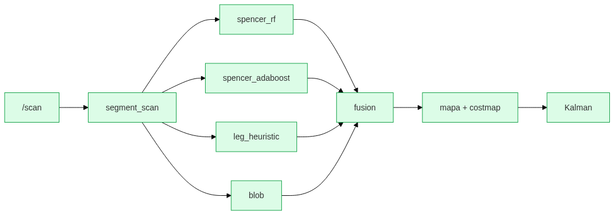

# LiDAR multi-detector pipeline

Un solo nodo ROS2 (`dynamic_tracking_node`): un `/scan` → segmentar una vez → varios
clasificadores → fusionar → filtros mapa → Kalman. Inspirado en
[Spencer `srl_laser_detectors`](https://gitlab.iri.upc.edu/labrobotica/ros/perception/people_tracking/spencer_people_tracking),
pero **varios detectores en paralelo** (Spencer clásico usaba **uno** por nodo).

## Flujo (diagrama)



Fuente: [`docs/diagrams/lidar_detectors_flow.mmd`](diagrams/lidar_detectors_flow.mmd)

## Modelos en el repo

| Carpeta | Archivos | Uso |
|---------|----------|-----|
| `models/spencer_rf/` | `*_noetic.random_forest.gz` | Rama GitLab **master** |
| `models/spencer_adaboost/` | `lms500_0.25deg_height70cm_rathausgasse.adaboost` | Rama GitLab **icra16** (FileStorage YAML) |

El `.adaboost.txt` es solo métricas de entrenamiento (F1≈0.87 en datos Freiburg); no hace falta para ejecutar.

## Spencer antiguo vs nuestro nodo

| | **old_spencer (ROS)** | **dynamic-tracking** |
|--|----------------------|----------------------|
| Detectores | **1** por launch (`type:=random_forest` **o** `adaboost` **o** `blob`) | **Varios** en `lidar_detectors_enabled` |
| Fusión ML | No mezclaba RF+AdaBoost a la vez | `lidar_fusion_policy: max_score` → `max(rf, ada, heur)` |
| Launch típico | `learned_detector_with_segmentation.launch` → RF por defecto | RF + AdaBoost + heurística |

En icra16 tenían **ambos** modelos en disco, pero en runtime elegías **uno** con el parámetro `type`.

## Parámetros YAML clave

```yaml
lidar_detectors_enabled: ["spencer_rf", "spencer_adaboost", "leg_heuristic"]
lidar_fusion_policy: "max_score"
spencer_rf_model_path: "models/spencer_rf/lms500_0.25deg_height70cm_fr_rathausgasse_noetic.random_forest.gz"
spencer_adaboost_model_path: "models/spencer_adaboost/lms500_0.25deg_height70cm_rathausgasse.adaboost"
spencer_adaboost_decision_threshold: -10.0
spencer_rf_only_positive_classifications: false
```

### Políticas de fusión

- **max_score** (prueba AdaBoost): sube el score si AdaBoost o heurística ven pierna aunque RF sea bajo (Gazebo).
- **require_two** (anti-FP): solo segmentos donde **≥2** detectores dicen `person` (p. ej. RF + heurística, o AdaBoost + heurística).

## Cómo probar y fijar default

1. `colcon build --packages-select dynamic_tracking --symlink-install`
2. Arrancar en Gazebo; en log: `LiDAR detectors: ['spencer_rf', 'spencer_adaboost', 'leg_heuristic']`
3. Si **mejor** recall sin más FP → dejar lista como está.
4. Si **más FP** en muros → quitar `spencer_adaboost` o usar `lidar_fusion_policy: "require_two"`.
5. Si **peor** que solo RF+heur → volver a `["spencer_rf", "leg_heuristic"]`.

## Añadir otro detector

1. Clase en `dynamic_tracking/lidar_detection/detectors/`.
2. Registrar en `build_lidar_pipeline()` (`pipeline.py`).
3. Añadir id en `lidar_detectors_enabled`.
