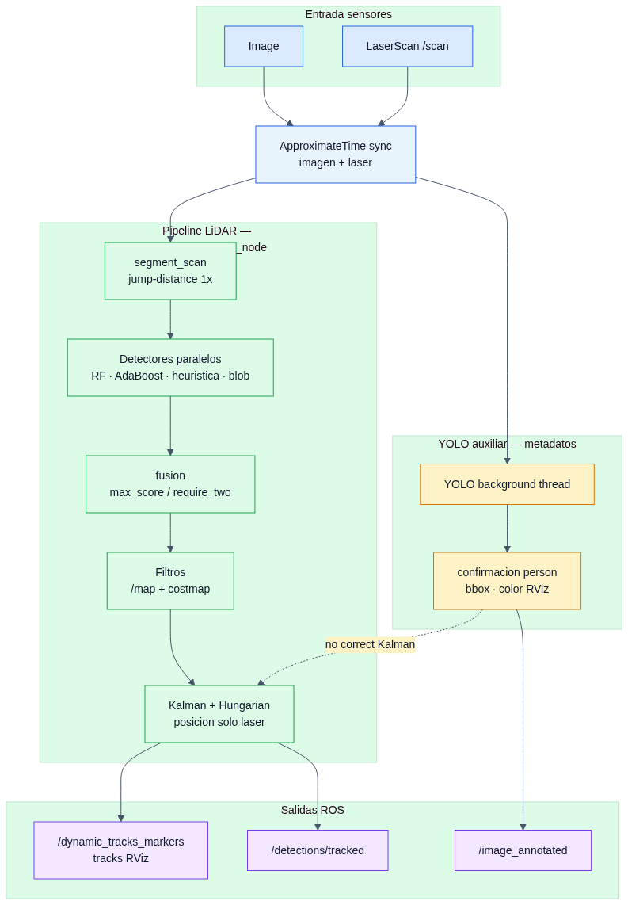
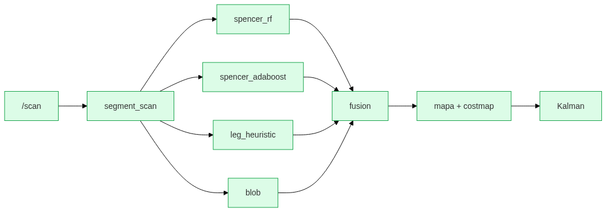

# Pipeline de `dynamic_tracking` — referencia técnica

## Flujo de datos (un ciclo con `sync_image_with_lidar`)

Detalle solo LiDAR (detectores y fusion): [LIDAR_DETECTORS.md](LIDAR_DETECTORS.md).  
Tracking (Kalman, verify, Spencer): [TRACKING.md](TRACKING.md).

### Diagrama del pipeline



| Color en el diagrama | Bloque |
|----------------------|--------|
| Azul | Entrada (`Image`, `LaserScan`) |
| Verde | Pipeline láser (segmentar → detectores → fusion → filtros → Kalman) |
| Amarillo | YOLO auxiliar (metadatos; **no** mueve posición Kalman) |
| Morado | Topics de salida |

**Leyenda:** la posición 3D del track la define **solo el láser**. YOLO confirma clase/color (`Person` / `DynObct`) y bbox en imagen.

### Solo rama láser (detalle)



### Editar o regenerar la imagen

- Fuente Mermaid: [`docs/diagrams/pipeline_flow.mmd`](diagrams/pipeline_flow.mmd) y [`lidar_detectors_flow.mmd`](diagrams/lidar_detectors_flow.mmd)
- Vista previa en [mermaid.live](https://mermaid.live)
- Regenerar PNG (con red):

```bash
python3 -c "
import base64, urllib.request
from pathlib import Path
mmd = Path('docs/diagrams/pipeline_flow.mmd').read_text()
enc = base64.urlsafe_b64encode(mmd.encode()).decode().rstrip('=')
url = f'https://mermaid.ink/img/{enc}?type=png&bgColor=FFFFFF'
Path('imgs/pipeline_flow.png').write_bytes(urllib.request.urlopen(url).read())
"
```

## LiDAR primero (comportamiento por defecto)

**Diseño:** la **posición** del track (Kalman `correct()`) la define **solo el LiDAR** en el nodo actual (`update_tracks(..., yolo_meas=[])`). **YOLO** aporta **metadatos** en imagen (clase, score, `last_bbox`, `last_rgb_person_sec`, color “verde” en RViz) vía `apply_yolo_auxiliary_person_confirmation` **sin** mover el estado. Con **`yolo_auxiliary_project_tracks_to_image: true`**, se rellena **fase 0**: proyección del track a `(u,v)` con varias alturas Z típicas (`yolo_auxiliary_projection_height_m`, suelo), `CameraInfo` + TF óptica←`tracking_frame`, y match si el punto cae dentro del bbox YOLO `person` (margen opcional en px). **`yolo_debug_laser_polar_markers`**: publica `/dynamic_tracking/yolo_laser_polar_markers` (MarkerArray, `frame_id` = último `/scan`): segmentos **verde** = rayo al hit YOLO en el plano laser, **cian** = `(r,θ)` de cada track (comparar alineación con la fase polar).

**Cascada LiDAR recomendada (robusta):** segmentación de `/scan` (una vez) → **N detectores** (`lidar_detectors_enabled`: RF, AdaBoost, heurística, blob) → **fusión** (`lidar_fusion_policy`) → filtro costmap/estático → asociación + Kalman. Ver [LIDAR_DETECTORS.md](LIDAR_DETECTORS.md).

**Fase 2 dual-tier (`lidar_dual_tier_enable: true`):** un solo `/scan` produce dos listas: **spawn** (`require_two`) solo para abrir ID; **maintenance** (`max_score`) para asociación y `correct()`. **Auditoría** (`person_track_dual_audit_*`): cada N ciclos, un track `person` sin match debe tener un cluster cercano con `spawn_tier_pass` (≥2 detectores) o YOLO reciente; si no, `scan_verify` no lo mantiene vivo.

Tras **fase 1** (`map_xy`), **`yolo_auxiliary_polar_match_enable`** activa **fase 1b**: cada detección guarda el **(rango, ángulo)** del hit en `/scan` en la dirección del bbox; se compara con el **(r, θ)** del track proyectado al frame del láser (útil si falla TF a mapa). **`yolo_auxiliary_bearing_match_enable`**: **fase 3** compara el ángulo `atan2(py,px)` en el frame del láser entre el punto del track en el suelo `(x,y,0)` y el rayo al centro/base del bbox (misma geometría que el rayo de fusión), sin depender de la proyección pinhole al pixel.

| Config | Tracking + posición 3D en RViz |
|--------|----------------------------------|
| `enable_yolo_detections: false` | 100 % láser; sin inferencia YOLO. |
| `enable_yolo_detections: true` y **`yolo_auxiliary_person_only: true`** | **Igual que la fila anterior**: `update_tracks(..., yolo_meas=[])` — YOLO **no** entra al Kalman ni al Hungaro. Solo `apply_yolo_auxiliary_person_confirmation` marca `person`/verde y bbox en imagen en el track láser ya existente. Los markers usan **`tr.state()`** (solo corrección láser). |
| `yolo_auxiliary_person_only: false` | Legacy: YOLO en asociación mapa. |

## Marcos y transformaciones

| Dato | Frame típico | Notas |
|------|----------------|-------|
| Puntos laser | `scan.header.frame_id` (p. ej. `base_laser_link`) | Rango + ángulo → `(x,y)` local laser. **`lidar_blind_zone_radius_m`**: no aceptar cluster si su centro está más cerca del origen del láser que `max(min_track_distance_m, blind_zone)` (recorta reflexión en chasis; en mapa parecía “ir con el robot”) |
| Proyección a mapa | `tracking_frame` (p. ej. `map`) | `lookup_transform(map, laser, stamp)`; si falla, reintento con “latest” |
| Rayo desde cámara | `image.header.frame_id` (óptica) | TF óptica→laser para bearing; scan del **mismo** callback sync |
| Filtro `/map` sobre clusters | `tracking_frame` → TF → `map` | Por defecto solo **centro** del cluster en `/map` (`static_map_neighbor_radius_cells`). Opcional: `static_map_corner_probe_enable` → sondas en **cruz** (5 puntos) si centro libre pero ≥2 cardinales en ocupado. **Disco Spencer** (`static_map_disk_filter_enable`): cuenta celdas libres en un círculo de radio `static_map_disk_radius_m`; si la fracción libre ≤ `static_map_disk_min_free_ratio`, se descarta (esquinas, apoyos en pared). Sin celdas dentro del mapa: `static_map_disk_permit_outside_map` |
| Asociación láser `person` | Fase 1: score ≥ `max(0.58, leg_min×0.88)`. **Fase 1b** (solo `person` sin RGB): score ≥ `max(0.38, min(leg_min×0.52, hi−ε), hi−0.08)` con `hi` = umbral fase 1 — evita que muros ~0.45–0.60 sigan corrigiendo el track cuando trabajas solo-LiDAR |
| Duplicados mismo punto | **NMS** IoU en mapa (`person_track_map_merge_min_iou`) + opcional **temporal** Spencer (`duplicate_track_*`): últimos N estados Kalman a menos de `duplicate_track_max_dist_m` en M de N ciclos → borra el track peor | `pose_trail_ring` alimenta duplicados y, si `publish_track_trajectory_markers`, **LINE_STRIP** RViz (`dynamic_tracks_trail`) |
| Filtro costmap Nav2 | `costmap` en `map` u `odom` | `occupancy_threshold` (253 = inscrita/letal). `map_filter_inflation_threshold`: casi siempre **0** porque el costmap global mezcla **dinámicos** (inflan a la gente). Margen solo en paredes: **`/map` + `static_map_neighbor_radius_cells`** |
| Fallback cámara→map | óptica | `transform_point_to_map` con profundidad fija o pixel depth |
| Marcadores RViz | Por defecto **`marker_visualization_frame` vacío** = markers en **`tracking_frame`** (`odom`); RViz con Fixed Frame `map` aplica TF **`odom→map`** (recomendado). Si pones **`marker_visualization_frame: map`**, el nodo remapea vértices (orden: stamp fusión, opcional imagen, `latest` solo si `marker_remap_allow_latest_fallback`). Con **`yolo_visual_lidar_parity`**: `last_update_source` **`lidar-only`**; **verde** = YOLO vio `person` hace ≤ **`person_yolo_seen_green_sec`**. Posición 3D; texto `TEXT_VIEW_FACING` solo traslación. |

**Aproximación planar:** `_transform_xy_to_map` usa solo **yaw** del TF (suelo 2D). Válido para bases móviles; error si el láser no está en el plano horizontal del mapa.

**Coherencia temporal:** clusters usan `scan.header.stamp`; con `lidar_fusion_use_scan_stamp_for_tf` y `/scan` disponible, `fusion_tf_stamp` es **siempre** el del scan (también en modo async imagen+laser), para que coincida con `_transform_xy_to_map` y con el remap `odom→map`. Sin LiDAR (`enable_lidar_fusion: false`), se usa el stamp de la imagen. El **Δt del Kalman** (`predict`) usa el intervalo entre **stamps de `fusion_tf_stamp`** (no entre llegadas del callback de imagen), para que no se corrompa si el callback se alarga (p. ej. esperando YOLO: mantén **`yolo_sync_wait_max_sec: 0`**). **`/detections` y `/detections/tracked`** usan `header.frame_id = tracking_frame` y ese mismo stamp (como `trackedPersons.header.frame_id = world_frame` en `ros_interface.cpp` de Spencer). Desfase medio imagen–scan es normal; `sensor_sync_slop` debe cubrirlo. Si RViz sigue desalineado con `marker_visualization_frame: map`, prueba **Fixed Frame = `odom`** y dejar `marker_visualization_frame` vacío (sin remap), como el `world_frame` por defecto del tracker Spencer.

## Kalman (OpenCV `cv2.KalmanFilter`)

- **Estado:** `[x, y, vx, vy]^T` en **mapa**.
- **Modelo:** velocidad constante; `F` pone `x += vx*dt`, `y += vy*dt` con `dt` del ciclo (acotado por `kalman_predict_dt_cap_sec` en el nodo).
- **Medición:** posición `(x, y)` en el Kalman la define **solo el láser** (o la predicción si no hay `correct()` ese ciclo). Con `person_yolo_defer_position_to_lidar: true` y `enable_lidar_fusion: true`, YOLO **nunca** llama a `correct()` para clase `person`: solo confirma identidad (clase, bbox en imagen, `last_rgb_person_sec`, color de fusión en RViz). Incluso si en un ciclo **no** hay `lidar_meas`, no se usa la proyección YOLO en mapa para el estado (antes, sin clusters, se volvía a YOLO). Con `person_yolo_defer_position_to_lidar: false`, la persona sí puede corregirse con YOLO en mapa como antes. Con `person_lidar_refinement_after_yolo`, el track sigue en la asociación láser aunque ya matcheó cámara. **`person_yolo_match_by_iou_first`** (por defecto `true` con defer+laser): antes del Hungarian en mapa, se emparejan **person↔YOLO person** por **IoU en imagen** (umbral `person_yolo_assoc_iou_min`), para que la identidad no dependa de `map_xy` inestable al girar; el resto de clases y detecciones no emparejadas siguen con distancia en mapa. **`yolo_lidar_fusion_label_only: true`**: YOLO no hace `correct()` en mapa para **ninguna** clase y no crea tracks desde la cámara; solo etiqueta/bbox/RGB; posición = láser + predicción. Los tracks que matchean YOLO (cualquier clase) se reinyectan al Hungarian láser (`all_yolo_matched_ti`), no solo los `person`, para que no queden excluidos y no deriven solo con `predict`. `person_rgb_coast_cl_sec` es **solo visual**. La exclusión opcional del matching láser va en `person_hold_skip_lidar_association_sec` (**0** recomendado). Con defer desactivado y láser en el mismo ciclo, el refinamiento puede debilitar la corrección YOLO (`person_yolo_weak_scale_with_lidar_refinement`).
- **Gate láser:** `person_lidar_innovation_gate_m` solo aplica a `person` con `last_rgb_person_sec` reciente y dentro de `person_lidar_innovation_gate_stale_rgb_sec`; fuera de esa ventana (o sin RGB nunca), no se aplica el gate — asociación hasta `tracking_person_lidar_assoc_cost_threshold`. **Con `enable_yolo_detections=false`, `last_rgb_person_sec` queda en 0 y el gate no actúa nunca** (por eso solo-láser se ve estable). **Con YOLO activo**, el mismo gate puede **vetar** pares track↔cluster si la innovación supera el umbral (p. ej. al girar); si además `person_yolo_defer_position_to_lidar` o `yolo_lidar_fusion_label_only` está activo, el pipeline **desactiva** ese gate para la DA láser, porque la posición ya no debe condicionarse a “RGB reciente”.
- **Fase 1b láser (suelo laxo):** por defecto solo entran `person` con `last_rgb_person_sec<=0`. Si hay YOLO y un track ya tiene RGB pero **no** hay cluster high-score ese frame, antes **no** pasaba a 1b ni a la fase 2 (solo `unknown`) → ciclos **sin** `correct()` láser → deriva que puede afectar a muchas cajas a la vez. Con defer/label-only, 1b también incluye esos `person` con RGB para reanclar al láser.
- **Imagen anotada:** cada track lleva `last_image_bbox_stamp_sec` cuando el bbox viene de YOLO en ese ciclo. Con `image_track_overlay_max_age_sec` > 0, la segunda capa (ID/etiqueta encima del bbox) no se dibuja si no hubo detección reciente — evita cajas “pegadas” cuando solo el láser actualiza el mapa. Las cajas del propio YOLO en el mismo callback siguen siendo solo detecciones del frame actual.
- **IDs duplicados:** si la asociación por distancia en mapa deja una medición YOLO sin track pero el IoU con un track no matcheado supera `yolo_merge_unmatched_iou`, se aplica la misma actualización que un match cámara en lugar de abrir un track nuevo.
- **Ruido:** `processNoiseCov` / `measurementNoiseCov` base en `Track` (OpenCV); **toda** corrección láser usa el mismo `correct()` sin escalar `R` por “RGB reciente” (YOLO no modifica el peso del cluster).

**Mejoras posibles (no implementadas):** matrices `R` distintas cámara/láser; filtro EKF completo si se incluye orientación explícita.

## Asociación

- **Algoritmo:** asignación global **Hungarian** (`scipy.optimize.linear_sum_assignment`; fallback greedy si no hay SciPy).
- **Coste:** distancia **euclídea** en mapa (predicción `association_position` ↔ medición), o **Mahalanobis al cuadrado** + **chi²** (2 DOF, 99% ≈ 9.21) si `use_mahalanobis_lidar: true` — alineado con el gating del `global_nearest_neighbor` de Spencer.
- **Clase:** `assoc_class_key(name) = hash(lower(strip(name)))`; tracks `unknown` pueden asociar a cualquier clase YOLO.
- **LiDAR:** umbral por track (`person` puede usar `tracking_person_lidar_assoc_cost_threshold`).

## Paridad con `srl_nearest_neighbor_tracker` (Spencer)

No ejecutamos el binario C++ ROS1, pero el pipeline ya refleja varias ideas del tracker Spencer:

| Idea Spencer | En este repo |
|--------------|----------------|
| GNN + innovación / Mahalanobis | `use_mahalanobis_lidar` + `Track.mahalanobis_sq` + `CHI2_99_2DOF` en `association.py` |
| MISSED vs OCCLUSION (fuera del FOV láser) | `is_track_in_lidar_fov` + `missed_frames` vs `consecutive_occlusions` en `track_pipeline.py` |
| Límites distintos maduro / no maduro | `max_occlusions_before_deletion`, `max_occlusions_mature_track`, `hits` y `_MATURE_HIT_THRESHOLD` |
| Actualización oclusa (predicción sin medición) | `Track.occluded_update()` |
| Comprobación de presencia en scan | `verify_track_in_scan` |
| Initiator / lógica de spawn | Clusters + spawn láser + filtros `/map`; distinto al `logic_initiator.cpp` línea a línea |
| `filter_detections_by_static_map` (disco libre/ocupado) | `static_map_disk_*` en `dynamic_tracking_node.py` tras pasar sondas centro/cruz |
| Debounce spawn solo-LiDAR `person` | `lidar_spawn_confirm_frames` / `lidar_spawn_confirm_radius_m` + `PendingLidarSpawn` en `track_pipeline.py` (0 = sin debounce) |
| Duplicados temporales (NNH) | `duplicate_track_temporal_enable` + `pose_trail_ring` | Alineado con `deleteDuplicateTracks` del tracker Spencer C++ |
| Stamp único del mensaje fusionado + TF con ese stamp | `fusion_tf_stamp` para rayo YOLO y para `header` de markers/remap | Evita mezclar geometría de un instante con `map`↔`odom` de otro |
| Cascada laser → cámara (sin doble tracking) | **`yolo_auxiliary_person_only`** (por defecto) | `update_tracks` recibe **lista vacía** de mediciones YOLO: predicción/corrección/spawn = solo LiDAR. `apply_yolo_auxiliary_person_confirmation`: match por distancia solo con **`map_xy` de rayo láser** (`lidar_rgb`) si **`yolo_auxiliary_distance_match_lidar_ray_only`**; tracks por debajo del umbral de hits (**`yolo_auxiliary_min_track_hits`**, 0 = `tracking_min_confirmed_hits`) no se confirman; `rgb_only` solo por IoU imagen. NMS sin `merge_lidar_only` con RGB. `false` = legacy (YOLO en el Hungaro) |

**Qué no está portado** (haría falta trabajo nuevo): `LaserShadeOcclusionManager` completo (muestreo de sombras entre láser y segmentación sincronizada), `polygon_occlusion_manager`, EKF 4D extendido del Spencer, parámetro `max_gating_distance` separado por modalidad. Para solo-LiDAR 2D, lo anterior suele ser suficiente; si necesitas sombras entre dos láseres, el siguiente paso sería lógica adicional o seguir usando el nodo Spencer en ROS1/bridge.

## Cuellos de botella típicos

1. **Sincronizador imagen+laser:** si un topic va lento, el callback baja de Hz y el log muestra “resto ~270 ms” (espera al par).
2. **YOLO:** en GPU suele ser ~5–15 ms; no suele dominar.
3. **Clustering del scan:** O(n beams); normalmente barato frente a sync.
4. **TF:** cache por `(frame, stamp)` reduce lookups repetidos.
5. **Filtro costmap:** una consulta por cluster; si el costmap es grande y hay muchos clusters, suma.

## Legibilidad y refactor sugerido (deuda técnica)

| Área | Estado | Sugerencia |
|------|--------|------------|
| `dynamic_tracking_node.py` (~1500 líneas) | Monolito | Extraer módulos: `tf_planar.py`, `yolo_map_fusion.py`, `costmap_filter.py`, `pipeline_tick.py` con una función `process_frame(ctx)`. |
| `update_tracks(...)` | Muchos argumentos | `dataclass` `TrackingParams` o leer de un objeto de configuración inmutable. |
| Diagnóstico | Contadores en el nodo | Clase pequeña `LidarFusionDiag` con `reset_interval()`. |
| Pruebas | Pocas | Tests unitarios de `assign_measurements`, `assoc_class_key`, `scan_window_best_range`, sin ROS. |

## Errores de posición habituales (no son bugs del Kalman en sí)

- **AMCL / pose:** saltos en `map`↔`base` hacen que las mediciones en mapa “salten”; el tracker solo fusiona mediciones, no corrige localización.
- **Umbral de asociación:** demasiado estricto → `missed_frames`; demasiado laxo → ID swaps.
- **Cámara sin detecciones:** sin `map_xy` de YOLO, solo queda LiDAR; ver logs `fusion: 0 detecciones objetivo`.
